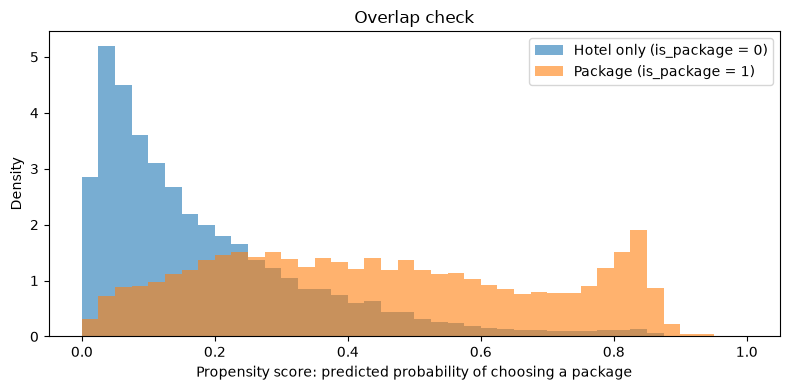

# Does the Flight + Hotel Package Increase Bookings? A Causal Analysis of Expedia Data

> Reports show that package searches have a lower booking rate. Is the package the problem, or are the people who choose packages simply different?
> This project uses causal inference to separate **customer differences** from **the effect of the package itself**.

🏨 **Code:** [`expedia_causal_inference.ipynb`](expedia_causal_inference.ipynb)

🏨 **Data:** [Kaggle – Expedia Hotel Recommendations](https://www.kaggle.com/competitions/expedia-hotel-recommendations/data) (`train.csv`, `destinations.csv`; not included in this repo because the files are too large)

## Conclusion

**Looking at the raw data:** for every 100 clicks, package searches lead to **4.3** bookings and hotel-only searches lead to **9.2**. The package seems to cost about 5 bookings.

**After removing the differences in who chooses a package:** the package itself accounts for only about **2** fewer bookings per 100 clicks.

In other words, **more than half of the gap in the report is not caused by the package**. It comes from the fact that package customers are different from hotel-only customers.

---

## 1. The question: can we trust the number in the report?

Expedia offers a "package" option (flight + hotel). I want to know: **does the package itself make customers more or less likely to book?**

| Role | Column | Meaning |
|---|---|---|
| Cause | `is_package` | Is this a package search? |
| Outcome | `is_booking` | Is this a booking (1) or only a click (0)? |

**Why is a direct comparison misleading?** Package customers usually travel further and spend more, so they compare options longer before they book. They are different from hotel-only customers from the start. A direct comparison mixes up **customer differences** with **the effect of the package**.

This is correlation, not causation. A classic example from the hotel industry: data may show that "guests who were moved to another room cancel more often". But the reason may be the other way round: hotels move guests who were already likely to cancel. If we get the direction of cause and effect wrong, we make the wrong business decision.

**Why not run an A/B test?** The best method would be to randomly decide who sees the package option, then compare the two groups. But this public dataset contains only historical records, not an experiment. So I use statistical methods to make the two groups comparable.

---

## 2. Data preparation

| Step | What I did | Why |
|---|---|---|
| Sampling | From 37.7 million rows, took 1% of the bookings and 1% of the clicks (about 375,000 rows) | The sample keeps the same booking rate as the full data (about 8%), and the sample can be reproduced |
| Destination features | Joined 149 destination features (`d1`–`d149`) from `destinations.csv` | They describe what kind of place each destination is; Expedia created them from hotel reviews |
| Unmatched destinations | Removed the 0.4% of rows with no matching destination | Very small share; it does not affect the result |
| Missing distances | 36% of distances were empty. Filled them with the median and added a column "was the distance filled in?" (yes = 1, no = 0) | 36% is too many rows to remove; the extra column lets the model tell real distances from filled ones |
| Category columns | Split columns such as country and website into yes/no columns, keeping the 20 most common values in each | These numbers are categories (for example "country no. 66"), not amounts |

---

## 3. Analysis steps

The structure follows the four steps of Microsoft's **DoWhy** library, which a senior data scientist in the Data Science Association Mentorship Program recommended to me for learning causal inference.

| Step | Question |
|---|---|
| **Step 1: Model** | Which factors should be controlled? |
| **Step 2: Identify** | Under these assumptions, can the effect be measured? |
| **Step 3: Estimate** | How big is the effect? |
| **Step 4: Refute** | Does the result hold up under tests? |

The version of DoWhy available for Python 3.14 (0.8) does not work with pandas 3, so I implemented every step myself with **pandas, NumPy and scikit-learn**. The logic is the same.

### Step 1. Model: which factors should be controlled?

Think about the **timeline** of a customer visiting the booking website:

| Timeline | What it is | Variables | Decision |
|---|---|---|---|
| Stage 1: who the user is | Exists before the visit | website, website continent, user country | **Control** |
| Stage 2: what they search for | Set before choosing a package | device, marketing channel, adults, children, rooms, destination type, hotel continent and country, distance, destination features `d1`–`d149` | **Control** |
| ── The customer chooses "package or hotel only" ── | | | |
| Stage 3: after the choice | Happens after the choice | the hotel clicked in the end (`hotel_cluster`), number of events in the same session (`cnt`) | **Do not control** |

**The rule:**

- Things that exist **before** the choice → **control**. They affect both "choosing a package" and "booking". Without control, they mix into the result.
- Things that happen **after** the choice → **do not control**. They are part of the package's effect. Controlling them would remove the effect we want to measure.

```
  User background     ──┐
  Search conditions   ──┼──►  is_package  ──►  is_booking
  Destination traits  ──┤                          ▲
                        └──────────────────────────┘
```

Two other groups of columns do not fit the timeline, so they are not controlled either:

- **Order unclear:** check-in date, check-out date, search time. We cannot tell if they happen before or after the package choice.
- **ID numbers:** user ID, region, city, destination ID, market ID. The size of an ID number has no meaning, and location is already covered by country and `d1`–`d149`.

### Step 2. Identify: can the effect be measured?

Yes. Among people with the same Stage 1 and Stage 2 conditions, the difference in booking rate between package and hotel-only searches is the effect of the package.

**Key assumption:** the timeline includes every factor that affects both "choosing a package" and "booking". If a factor is missing from the data (for example, "this person had already decided to travel abroad"), the result can still be biased. This limitation cannot be avoided with historical data.

### Step 3. Estimate: how big is the effect?

I compare three methods, from the simplest to the most careful:

| Method | How it works |
|---|---|
| **Simple comparison** | Booking rate of package searches − booking rate of hotel-only searches, with no control |
| **Linear regression** | Measures the effect of the package when all other conditions are the same |
| **Propensity score weighting** (main method) | First predicts how likely each person is to choose a package, then weights people so both groups have the same background, and compares them |

**Result: how many more or fewer bookings per 100 clicks does the package bring?**

| Method | Result |
|---|---:|
| Simple comparison | 4.9 fewer |
| Linear regression | 2.7 fewer |
| Propensity score weighting: everyone | 4.1 fewer |
| **Propensity score weighting: people who actually chose a package** | **2.1 fewer** |

**The last row is the main result.** For people who actually chose a package, the package accounts for about 2 fewer bookings per 100 clicks. Linear regression (2.7 fewer) gives a similar answer. The overlap check below explains why the "everyone" row is not the main result.

**Overlap check: can we find people to compare with?**



Propensity score weighting compares each package customer with hotel-only customers who have **a similar background**. This chart checks **whether such people exist**. The horizontal axis shows how likely each person was to choose a package. Orange = package customers, blue = hotel-only customers.

- **Wherever there is orange, there is also blue** → the result for "people who actually chose a package" is reliable.
- **Many blue customers sit on the far left:** about 16% of people had less than a 5% chance of choosing a package (for example, people looking for a nearby hotel who need no flight). Imagining that these people choose a package is not realistic, so the "everyone" row (4.1 fewer) is less reliable.

### Step 4. Refute: does the result hold up?

I tried to break the result in three ways. The tests use the propensity score weighting estimate for everyone (−4.07):

| Test | What I did | Result | What it means |
|---|---|---|---|
| Placebo test | Randomly shuffled "package or not" | The effect became **−0.10** (almost 0) | The effect disappears after shuffling, so the original result is not a coincidence |
| Random common cause | Added a column of pure random numbers | The effect **did not change** (−4.07) | The result is not affected by unrelated information |
| Data subset | Recalculated with a random 80% of the data, 3 times | **−3.96, −4.11, −4.15** | The result stays stable with different data |

All three tests passed, which shows that the calculation does not create an effect from nothing.

---

## 4. What this means for product decisions

A report alone would suggest that the package costs about 5 bookings per 100 clicks, which could lead to showing the package less often. After removing customer differences, the effect of the package itself is only about half of that.

Also, the booking rate here is measured **per click**. A package is a bigger decision, so customers naturally look more times before they book. The remaining gap does not necessarily mean that the package makes people less willing to book.

---

## 5. Limitations and next steps

**Limitations**

- Only factors in the data can be controlled. Missing factors, such as "this person had already decided to travel abroad", cannot be ruled out.
- Each row is **one click**, not one person. The same person may appear many times.
- The data is anonymised and from 2013–2014. The goal is to practise the method.

**Next steps**

1. **Individual treatment effects:** the current result is an average, but the package may affect people differently. For example, it may help long-distance travellers but not short-distance ones. Knowing who it helps would let the product show packages only to the right people.
2. **Measure per user:** check whether each person booked in the end, instead of looking at each click.
3. **A/B test:** use these results to choose which customer groups to test, then confirm with an experiment.
